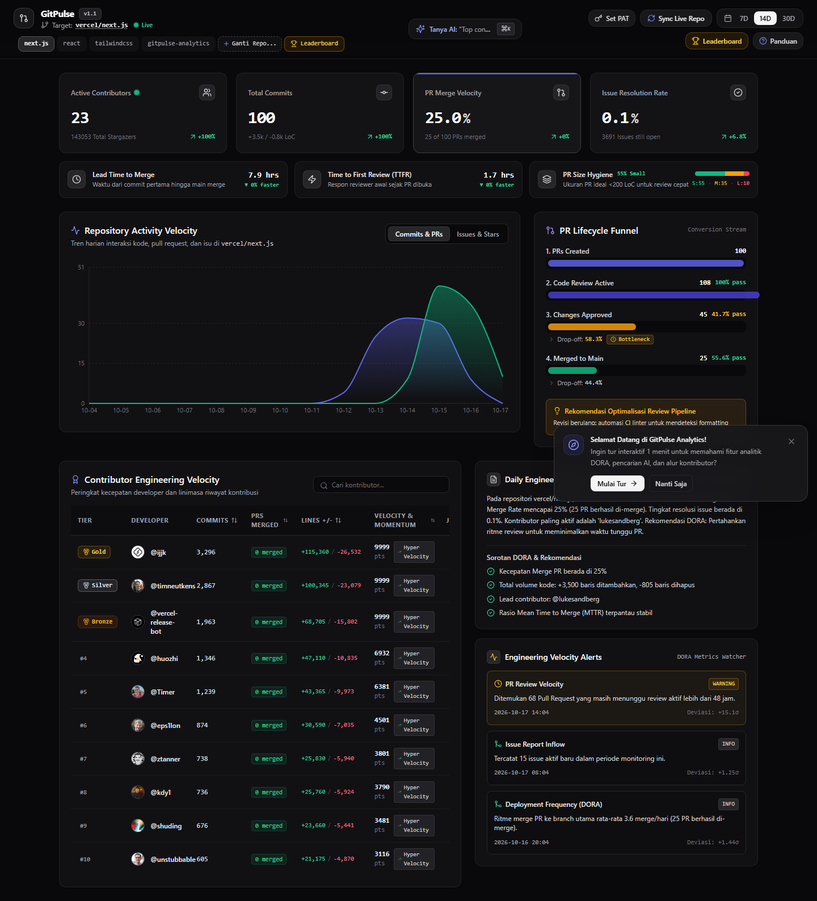
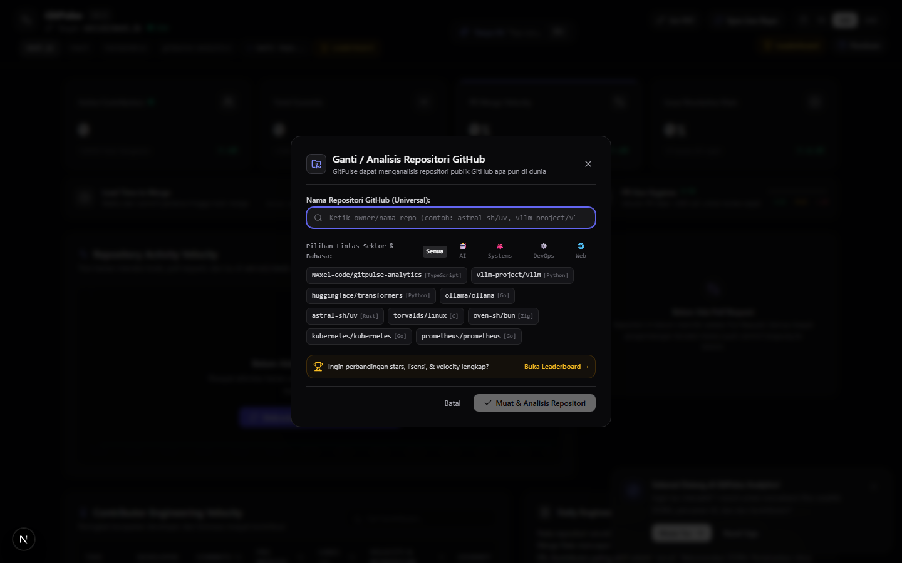
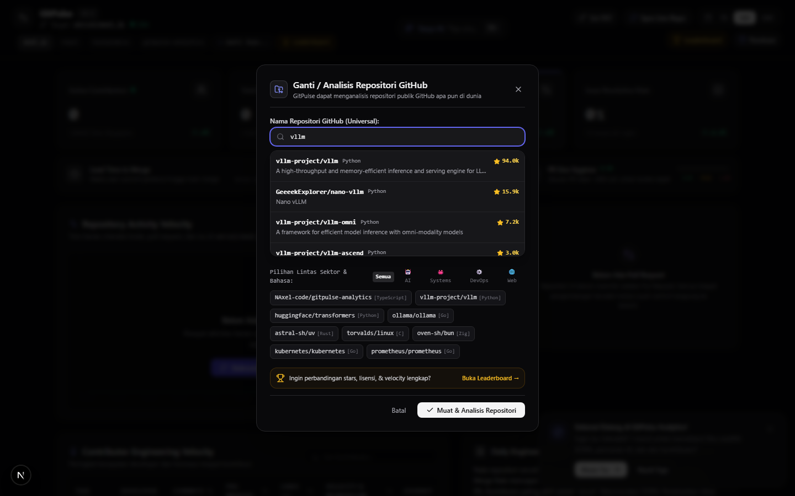
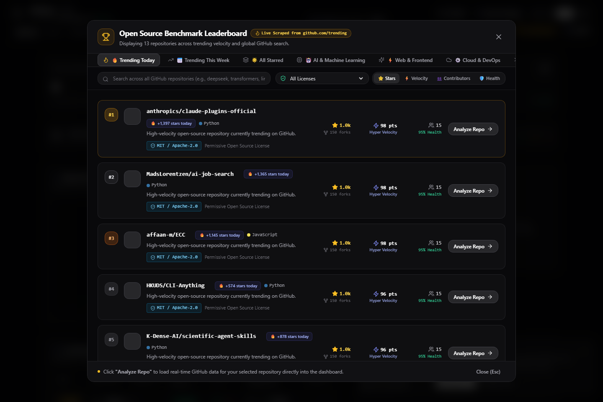
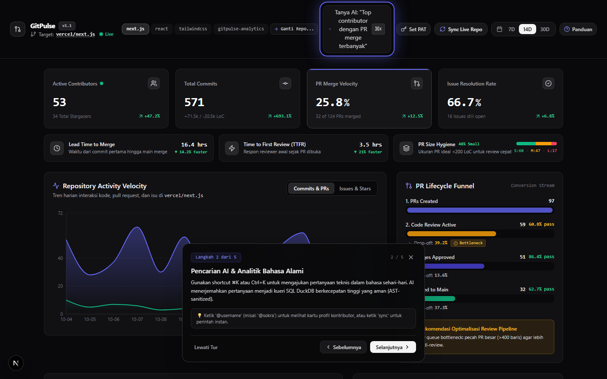
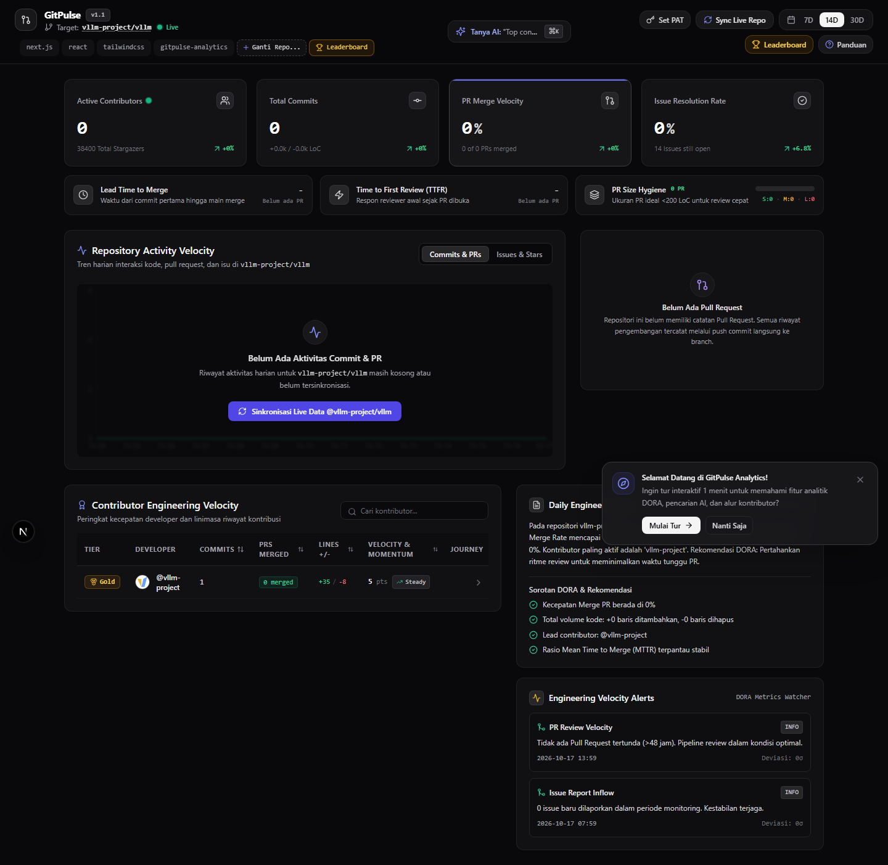

# ⚡ GitPulse Analytics

<p align="center">
  <b>🌐 <a href="README.md">English</a> | <a href="README.id.md">Bahasa Indonesia</a></b>
</p>

> **High-Performance GitHub Developer & Repository Intelligence Platform**  
> Universal DORA metrics, software engineering velocity tracking, and contributor journey timelines for any public GitHub repository worldwide.

[](https://frontend-theta-beige-69.vercel.app)
[](https://nextjs.org)
[](https://fastapi.tiangolo.com)
[](https://duckdb.org)
[](https://github.com/NAxel-code/gitpulse-analytics/issues?q=is%3Aissue+is%3Aclosed)

---

## 📸 Production Dashboard Interface (Live Preview)


*Live production analytics dashboard deployed on Vercel (`https://frontend-theta-beige-69.vercel.app`) rendering real-time DORA indicators, code velocity trends, PR conversion funnel, and contributor leaderboards.*

---

## 🌐 Universal Architecture & Core Features

GitPulse Analytics is engineered with a **Universal Serverless + Hybrid Columnar Engine** architecture, delivering instant analytical insights for any public repository across various domains (AI/ML, Systems, DevOps, Web, Mobile) without requiring complex database configurations.

### 1. 🔍 Live GitHub Search Autocomplete & Universal Switcher
Users can search, switch, and analyze any open-source repository globally by simply typing an owner/repository name or GitHub organization.
* **Debounced Live Autocomplete:** Instant repository discovery with live GitHub star counts, primary programming languages, and project descriptions.
* **Multi-Sector Categorization:** Rapid preset filtering across ecosystem domains (*🤖 AI & ML*, *🦀 Systems*, *⚙️ Cloud & DevOps*, *🌐 Web & Frontend*, *📱 Mobile*).

<p align="center">
  
  
</p>

### 2. 🏆 Live GitHub Trending & Global Benchmark Leaderboard
A strategic engineering instrument to benchmark repository velocity and community momentum against world-class open-source projects, powered by live scraping from `github.com/trending` and dynamic GitHub Search API queries.
* **🔥 Real-Time GitHub Trending:** Live scraped feeds from `https://github.com/trending` featuring *Daily Trending* (with exact `+X stars today` metrics) and *Weekly Trending* momentum rankings.
* **⚡ Universal Search Across All GitHub Repositories:** Real-time debounced search powered by the GitHub Search API, discovering and evaluating any public repository with instantaneous zero-latency ranking.
* **Multi-Sector & License Categorization:** Filter across sectors (*🤖 AI & ML*, *⚡ Web*, *⚙️ Cloud & DevOps*, *🦀 Systems*, *📱 Mobile*) and standard enterprise licenses (*MIT*, *Apache-2.0*, *BSD-3*, *GPL*).
* **Momentum & Health Signals:** Tracks *Community Stars*, *Health Scores* (0–100), and *Velocity Ratings* (*Hyper Velocity*, *High Momentum*, *Steady*).
* **1-Click Deep Dive:** Instantly load and inspect any benchmarked repository directly on the primary analytics dashboard.

<p align="center">
  
</p>

### 3. ⏱️ DORA Metrics & Engineering Speed
* **Lead Time to Merge & Time to First Review (TTFR):** Tracks elapsed duration from the initial commit to default branch merge, alongside initial reviewer response latency.
* **PR Size Hygiene:** Analyzes pull request size distribution (Small <200 LoC, Medium, Large) to prevent code review gridlocks and maintain clean delivery pipelines.
* **DORA Anomaly Watcher:** Automatically detects development anomalies (*stale PRs*, bug report surges, deployment cadence dips) using statistical *Z-score* deviation modeling.

### 4. 📉 PR Lifecycle Funnel & Bottleneck Detection
A 4-stage conversion analytics stream (*PRs Created* $\rightarrow$ *Code Review Active* $\rightarrow$ *Changes Approved* $\rightarrow$ *Merged to Main*) that proactively flags critical drop-offs (>25%) and surfaces actionable pipeline optimization guidance.

### 5. 🧭 Interactive Guided Spotlight Tour & DORA Cheatsheet
* **Zero-Blur SVG Cutout Mask:** An interactive 5-step onboarding walkthrough highlighting core controls crisply without obscuring or blurring target DOM elements.
* **Quick Documentation Center (`?`):** Press `?` anytime to open the DORA glossary, AI natural language syntax cheatsheet, and global keyboard shortcuts.

<p align="center">
  
</p>

### 6. 💬 Natural Language Code Analytics (`⌘K` / `Ctrl+K`)
Query development analytics using plain conversational English (e.g., *"Top human contributors"*, *"PR status distribution"*, or *"Daily commit activity trend"*), secured by AST SQL sanitization (*sqlglot*) and automatic intent detection.

<p align="center">
  
</p>

### 7. 🔌 Model Context Protocol (MCP) Server
Native integration with Claude Desktop, Cursor, and agentic coding workflows via standard MCP tools to query DORA metrics, developer velocity journeys, and PR bottlenecks directly inside LLM tool-calling loops.

---

## 📋 Resolved GitHub Issues & Fixes Traceability

All feature implementations, UX refinements, and bug fixes are transparently tracked in the repository issue tracker:

| Issue | Type | Title & Architectural Solution | Commit | Status |
| :---: | :---: | :--- | :---: | :---: |
| [#1](https://github.com/NAxel-code/gitpulse-analytics/issues/1) | `feat` | **Interactive Guided Walkthrough Tour & DORA Cheatsheet:** 5-step onboarding tour with `?` shortcut trigger and interactive welcome banner. | [`25bbff9`](https://github.com/NAxel-code/gitpulse-analytics/commit/25bbff9) | `CLOSED` |
| [#2](https://github.com/NAxel-code/gitpulse-analytics/issues/2) | `feat` | **Arbitrary Repository Switcher & AI Routing:** Removed preset limitations to support analyzing any public GitHub repository worldwide. | [`a2fa8b7`](https://github.com/NAxel-code/gitpulse-analytics/commit/a2fa8b7) | `CLOSED` |
| [#3](https://github.com/NAxel-code/gitpulse-analytics/issues/3) | `fix` | **Activity Timeline Blank Chart Fix:** Resolved Recharts JSX fragment errors and axis domain clipping with automated date gap-filling. | [`541a674`](https://github.com/NAxel-code/gitpulse-analytics/commit/541a674) | `CLOSED` |
| [#4](https://github.com/NAxel-code/gitpulse-analytics/issues/4) | `fix` | **Spotlight Backdrop Blur Cutout:** Replaced CSS radial blur with a dual-layer SVG cutout mask so highlighted elements remain sharp. | [`9d58db8`](https://github.com/NAxel-code/gitpulse-analytics/commit/9d58db8) | `CLOSED` |
| [#5](https://github.com/NAxel-code/gitpulse-analytics/issues/5) | `fix` | **100% Factual GitHub Data & Responsive Search Layout:** Stripped synthetic mock data and corrected AI search input overflow on medium viewports. | [`0862280`](https://github.com/NAxel-code/gitpulse-analytics/commit/0862280) | `CLOSED` |
| [#6](https://github.com/NAxel-code/gitpulse-analytics/issues/6) | `feat` | **Sector Benchmark Leaderboard:** Multi-sector comparative modal (AI, Systems, Cloud, Web, Mobile) with star ratings, licenses, and velocity scores. | [`05af35e`](https://github.com/NAxel-code/gitpulse-analytics/commit/05af35e) | `CLOSED` |
| [#7](https://github.com/NAxel-code/gitpulse-analytics/issues/7) | `feat` | **Pure Next.js Universal Serverless Architecture & Live Autocomplete:** Ported DORA engine to Next.js route handlers with live debounced search. | [`72900f6`](https://github.com/NAxel-code/gitpulse-analytics/commit/72900f6) | `CLOSED` |

---

## 🛠️ Tech Stack & Architecture

* **Frontend:** Next.js 15 (App Router, Serverless Route Handlers), TypeScript, Tailwind CSS, Lucide Icons, Recharts, Magic UI.
* **Serverless Intelligence Engine:** Native TypeScript GitHub Ingestion & DORA Calculation Engine (`frontend/src/lib/github-serverless.ts`).
* **Alternative Local/Self-Hosted Backend:** FastAPI, Python 3.12, DuckDB Columnar OLAP, Pydantic, sqlglot AST Validator.
* **AI Agent Integration:** Model Context Protocol (MCP) Server (`backend/app/mcp/server.py`).
* **Deployment & Cloud Infrastructure:** Vercel Production Serverless ([Live Preview](https://frontend-theta-beige-69.vercel.app)), Docker Multi-stage Builds (~95 MB).

---

## 🚀 Getting Started

### Option 1: Run Serverless Frontend (Fastest)
Requires zero Python or separate database setup. Simply run with Node.js 20+:

```bash
cd frontend
npm install
npm run dev
```
Open your browser at [http://localhost:3000](http://localhost:3000).

### Option 2: Fullstack Local Environment (Next.js + FastAPI + DuckDB)
```powershell
# Execute the automated PowerShell bootstrap script:
.\start_dev.ps1
```
* **Frontend Application:** [http://localhost:3000](http://localhost:3000)
* **Backend OpenAPI Documentation:** [http://localhost:8000/docs](http://localhost:8000/docs)

### Option 3: Docker Compose
```bash
docker compose up -d --build
```

---

## 🧪 Testing & Verification

GitPulse is backed by automated test suites ranging from unit specifications to Browser E2E validation:

```bash
# 1. Run automated Playwright E2E browser tests:
python tests/test_universal_repo_switch.py
python tests/test_leaderboard_flow.py

# 2. Run backend test suite (pytest):
pytest -v backend/tests

# 3. Run frontend unit tests:
cd frontend && npm test
```

---

## 📄 License & Contributing

Distributed under the **MIT License**. Contributions, feature ideas, and issue submissions are warmly welcomed via [GitHub Issues](https://github.com/NAxel-code/gitpulse-analytics/issues).
